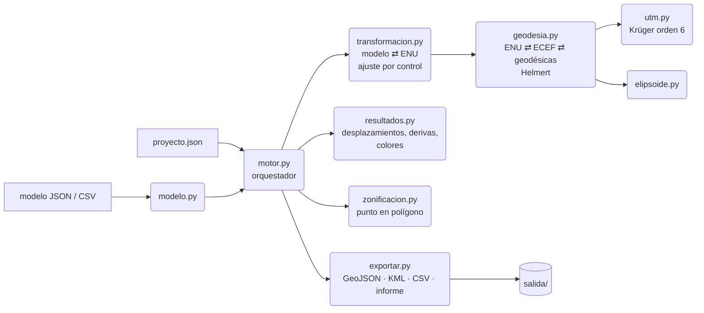

# Guion de funcionamiento: módulo de georreferenciación de análisis estructural

**Proyecto:** Tav0t · **Módulo:** `tav0t.georef` · **Versión del documento:** 0.1

Este documento explica qué hace el módulo, cómo funciona por dentro y cómo se
implementa paso a paso. El código de referencia en `tav0t/georef/` sigue este
documento al pie de la letra: cada sección indica el archivo que la implementa.

---

## 0. Resumen

El módulo recibe un **modelo estructural** (nodos, elementos y resultados del
análisis en coordenadas locales X, Y, Z) y lo **coloca en la Tierra**. Para cada
nodo calcula latitud, longitud, altura y coordenadas UTM. Además lleva los
desplazamientos a direcciones reales (Este, Norte, Arriba), calcula las derivas
de entrepiso, clasifica los elementos por colores, consulta la zonificación del
sitio y exporta todo a GeoJSON (SIG), KML (Google Earth) y CSV. Al final deja un
informe con controles de calidad.

Funciona con un **motor propio**: todo el cálculo geodésico está implementado en
el módulo, en Python puro, sin QGIS, ArcGIS, PROJ, GDAL ni ninguna otra
biblioteca externa. Su precisión se comparó con PROJ, la referencia mundial, y
la diferencia es inferior a 0.00001 mm (sección 9).

---

## 1. Objetivo y alcance

### 1.1 Qué hace

1. Georreferencia el modelo por uno de dos métodos:
   - **Paramétrico:** un punto de amarre conocido y el acimut del eje X.
   - **Por puntos de control:** ≥ 2 puntos levantados en campo, con ajuste por
     mínimos cuadrados y residuos.
2. Convierte entre sistemas: modelo ↔ ENU ↔ ECEF ↔ geodésicas ↔ UTM, con
   cambio de datum (Helmert 7 parámetros) y de tipo de altura.
3. Rota los resultados vectoriales (desplazamientos) a ejes geográficos.
4. Calcula derivas de entrepiso por columna y las compara con el límite.
5. Clasifica los elementos por una métrica (relación demanda/capacidad,
   desplazamiento…) en una escala de colores.
6. Consulta la zonificación (sísmica, de suelos…) en el punto de amarre.
7. Exporta GeoJSON, KML y CSV, y genera un informe JSON trazable.

### 1.2 Qué NO hace (por diseño)

- **No hace el análisis estructural.** Consume los resultados que produce el
  motor de análisis (de la plataforma o de un programa externo).
- **No trae valores de ninguna norma.** Las zonas sísmicas, los límites de
  deriva y los factores de amplificación son datos del proyecto, así se
  actualizan sin tocar el código y sirven para cualquier país.
- **No incluye un modelo geoidal.** La ondulación geoidal N del sitio se indica
  como dato (se obtiene una sola vez por proyecto del modelo oficial, p. ej.
  EGM2008). Ver hoja de ruta.

---

## 2. Conceptos que el módulo debe respetar

Un error de concepto aquí produce errores de metros o de grados. Estos son los
puntos que el módulo resuelve de forma explícita.

### 2.1 Sistemas de coordenadas

| Sistema | Qué es | Unidades | Dónde se usa |
|---|---|---|---|
| **Modelo** | Cartesiano local del programa de análisis. Origen y orientación arbitrarios. | m, cm, mm, ft, in | Entrada |
| **ENU** | Plano tangente local en el punto de amarre: Este, Norte, Arriba. Sin distorsión. | m | Sistema intermedio donde se coloca el modelo |
| **ECEF** | Cartesiano geocéntrico (centro de la Tierra). | m | Puente entre ENU y geodésicas, y para el cambio de datum |
| **Geodésicas** | Latitud φ, longitud λ, altura elipsoidal h. | °, °, m | Salida GeoJSON y KML |
| **UTM** | Proyección cartográfica plana por zonas de 6°. | m | Salida CSV/informe y entrada de planos topográficos |

### 2.2 Por qué el modelo se coloca en ENU y no directamente en UTM

La cuadrícula UTM **no conserva las distancias**. Su factor de escala k va de
0.9996 en el meridiano central a ≈1.001 en los bordes de zona. Además, a la
altura de la obra se suma el *factor de elevación*. Si se "pega" el modelo
sobre coordenadas UTM, un edificio de 100 m medido en el modelo ocupa 99.93 m
o 100.04 m sobre el plano.

Por eso el módulo coloca el modelo en el plano tangente local ENU, donde las
distancias son reales, y proyecta a UTM **punto por punto al final**. La
geometría se conserva exactamente, y la distorsión de la proyección se aplica
solo donde corresponde.

> Ejemplo real del proyecto de ejemplo (2600 m s. n. m., zona 18N):
> factor combinado = 0.99932664 → **1 km de obra = 999.327 m en la cuadrícula
> UTM (67 cm de diferencia)**. En el edificio de 12 m son 8 mm.

### 2.3 Norte verdadero y norte de cuadrícula

- **Norte verdadero (geográfico):** dirección del meridiano.
- **Norte de cuadrícula:** dirección del eje N de la cuadrícula UTM.
- La diferencia es la **convergencia de meridianos γ**, medida en sentido
  horario desde el norte verdadero hasta el norte de cuadrícula:

```math
\text{acimut verdadero} = \text{acimut de cuadrícula} + \gamma
```

Internamente el módulo trabaja siempre con **acimut verdadero**. Si el acimut
del eje X se midió sobre un plano topográfico en UTM, se declara
`"norte": "cuadricula"` y el módulo hace la corrección.

### 2.4 Alturas: elipsoidal y ortométrica

- **h (elipsoidal):** altura sobre el elipsoide WGS84. Es la que usan GPS/GNSS,
  ECEF y GeoJSON.
- **H (ortométrica):** altura sobre el nivel medio del mar (geoide). Es la que
  aparece en planos, cotas de proyecto y Google Earth.
- Se relacionan con la **ondulación geoidal N** del sitio:

```math
h = H + N
```

N varía entre unos −106 m y +85 m en el mundo, así que confundir las dos
alturas puede producir errores de decenas de metros en vertical. El módulo pide `tipo_altura` en cada dato de entrada y
`ondulacion_geoidal` en el proyecto. Si falta, avisa.

### 2.5 Datum

Las coordenadas de entrada pueden estar en un datum distinto de WGS84 (p. ej.
PSAD56, datums locales antiguos). Para pasarlas al datum de trabajo se aplica
una **transformación de Helmert de 7 parámetros**.

SIRGAS (y sus densificaciones nacionales, como MAGNA-SIRGAS), ITRF y WGS84
difieren típicamente en menos de un metro. La diferencia se debe sobre todo al
movimiento de las placas entre las épocas de referencia, y suele bastar para
ubicar una obra en el mapa. Para precisión centimétrica, use la época y los
parámetros oficiales. NAD83 sí difiere de WGS84 en 1-2 m y requiere
transformación.

### 2.6 Orientación del modelo

- El modelo es **dextrógiro**. Su eje vertical es Z (SAP2000, ETABS y la
  mayoría) o Y (algunos programas y los modelos 2D de OpenSees).
- El **acimut del eje X** es el ángulo, en sentido horario desde el norte, hacia
  donde apunta el eje +X del modelo. Con Z vertical, el eje +Y apunta 90° en
  sentido antihorario desde +X.
- El eje vertical del modelo coincide con la **vertical local en el punto de
  amarre**.

---

## 3. Arquitectura del motor propio



| Archivo | Responsabilidad |
|---|---|
| `elipsoide.py` | Constantes de los elipsoides (WGS84, GRS80, Internacional 1924). |
| `geodesia.py` | Geodésicas ⇄ ECEF ⇄ ENU. Helmert de 7 parámetros. |
| `utm.py` | Proyección UTM directa e inversa, convergencia y factor de escala. |
| `transformacion.py` | Clase `Georreferencia` (modelo ⇄ ENU ⇄ geodésicas/UTM, rotación de vectores) y ajuste por puntos de control. |
| `modelo.py` | Formato neutro del modelo, validación y carga desde JSON/CSV. |
| `resultados.py` | Nodos georreferenciados, desplazamientos ENU, deformada, derivas y escala de colores. |
| `zonificacion.py` | Consulta de la zona que contiene un punto. |
| `exportar.py` | Escritura de GeoJSON, KML, CSV e informe. |
| `motor.py` | Orquestación del flujo completo (sección 4). Punto de entrada para la plataforma. |
| `cli.py` | Línea de comandos. |

**Principios de diseño:**

1. **Sin dependencias:** solo la biblioteca estándar de Python 3.10+.
2. **Formato neutro:** cualquier programa de análisis entra por el mismo
   formato JSON. Agregar un programa nuevo solo requiere un adaptador.
3. **Contrato JSON:** entrada `proyecto.json` y salida `informe.json`. La
   plataforma puede estar escrita en cualquier lenguaje.
4. **Determinista y trazable:** la misma entrada siempre da la misma salida, y
   el informe guarda los parámetros usados y los controles de calidad.
5. **Validar antes de calcular:** los errores se detectan al principio con
   mensajes claros en español.

---

## 4. Flujo de funcionamiento paso a paso

Implementado en `motor.py → ejecutar()`. Cada paso indica qué hace, cómo lo
hace y qué valida.

### Paso 1. Leer y validar la configuración

- **Entrada:** `proyecto.json` (sección 6.3).
- **Hace:** resuelve las rutas relativas respecto a la carpeta del proyecto,
  elige el elipsoide (WGS84 por defecto), los formatos de salida y la zona UTM
  (si se fuerza).
- **Valida:** que existan las claves obligatorias, que los formatos de salida
  sean conocidos y que el elipsoide exista. Si algo falla, lanza
  `ErrorConfiguracion` indicando exactamente qué falta.

### Paso 2. Cargar y validar el modelo

- **Entrada:** modelo en JSON neutro o tablas CSV (sección 6).
- **Hace:** construye `ModeloEstructural` con nodos, elementos y casos de
  resultados. Los IDs se tratan como texto (SAP2000 permite nombres).
- **Valida:**
  - Error: nodos o elementos duplicados, elementos con nodos inexistentes,
    barras con < 2 nodos, áreas con < 3 nodos, tipos o unidades desconocidas, o
    un modelo sin nodos.
  - Advertencia: resultados de nodos o elementos que no existen (se ignoran).

### Paso 3. Normalizar las coordenadas de referencia

Toda coordenada de referencia (punto de amarre o puntos de control) pasa por el
mismo conversor (`_ConversorCoordenadas`):

1. Si viene en UTM, se pasa a geodésicas con el elipsoide del datum de origen.
2. Si la altura es ortométrica: h = H + N.
3. Si hay `datum_origen`: geodésicas → ECEF → Helmert → ECEF → geodésicas en el
   elipsoide de trabajo.

**Resultado:** (φ, λ, h) en el datum de trabajo, con altura elipsoidal.

### Paso 4. Construir la georreferencia

**Método paramétrico** (`Georreferencia.parametrica`):

1. Punto de amarre geodésico (φ₀, λ₀, h₀) y el punto del modelo que le
   corresponde (x₀, y₀, z₀), por defecto el origen.
2. Acimut del eje X. Si es de cuadrícula, se suma la convergencia γ en el
   amarre.
3. Factor de unidad del modelo y eje vertical.

**Método por puntos de control** (`ajustar_puntos_control`, sección 5.5):

1. Cada punto tiene coordenadas de modelo y coordenadas de terreno.
2. Ajuste por mínimos cuadrados de giro y traslación (y de escala solo si se
   permite).
3. Calcula los residuos por punto, el RMS horizontal y vertical, y la escala
   estimada.
4. Avisa si hay solo 2 puntos (sin redundancia), si el RMS supera la tolerancia
   o si la escala estimada se aleja de 1 (típico error de unidades).

**Siempre:** se calculan los datos de cuadrícula en el amarre: zona,
convergencia, acimut de cuadrícula del eje X, k, factor de elevación y factor
combinado.

### Paso 5. Georreferenciar nodos, desplazamientos y deformada

Para cada nodo (`resultados.georreferenciar_modelo`):

1. Modelo → ENU → ECEF → (φ, λ, h).
2. (φ, λ) → UTM, **todos en la misma zona** (la del amarre o la forzada) para
   que las coordenadas sean continuas aunque la obra cruce un borde de zona.
3. H = h − N.
4. Si hay caso de resultados, el desplazamiento (ux, uy, uz) se **rota** a
   ejes ENU (sin trasladarlo) y se convierte a metros.
5. Si se pidió deformada, la posición deformada es
   `nodo + factor_deformada × desplazamiento` en el modelo, georreferenciada
   igual que los nodos.

**Selección del caso:** se usa el indicado en `resultados.caso`. Si no se
indica y el modelo tiene un solo caso, se usa ese. Si hay varios, se avisa y se
georreferencia solo la geometría.

### Paso 6. Derivas de entrepiso

Ver sección 5.8. Se calculan en las direcciones X e Y **del modelo**, que es
como las piden las normas, y como resultante. Se marcan los pisos que superan
`limite_deriva`.

### Paso 7. Clasificación por colores

1. Métrica por elemento (`metrica_color`):
   - Un resultado de elemento del caso (p. ej. `relacion_dc`).
   - `desplazamiento`: el máximo desplazamiento total de los nodos del elemento.
2. La métrica se clasifica con `umbrales` crecientes [u₁, u₂, u₃] en 4 clases
   con paleta semáforo: verde < u₁ ≤ amarillo < u₂ ≤ naranja < u₃ ≤ rojo.

### Paso 8. Zonificación

Si el proyecto indica un GeoJSON de zonificación, se busca el polígono que
contiene el punto de amarre (sección 5.10) y se copian sus propiedades al
informe. Si el punto cae fuera de todos, se avisa.

### Paso 9. Exportación

Genera los formatos pedidos en `salidas.formatos` (sección 7).

### Paso 10. Informe

Escribe el informe JSON, que se devuelve también a quien llamó al motor, con
los parámetros, los controles de calidad, los resultados resumidos, las rutas
de los archivos y todas las advertencias.

---

## 5. Algoritmos al detalle

Notación: a = semieje mayor, f = achatamiento, e² = f(2 − f),
φ = latitud, λ = longitud, h = altura elipsoidal.

### 5.1 Geodésicas → ECEF (`geodesia.geodesicas_a_ecef`)

```math
N(\varphi) = \frac{a}{\sqrt{1 - e^2 \sin^2\varphi}}
```

```math
X = (N + h)\cos\varphi\cos\lambda,\quad
Y = (N + h)\cos\varphi\sin\lambda,\quad
Z = \left(N(1 - e^2) + h\right)\sin\varphi
```

### 5.2 ECEF → geodésicas (`geodesia.ecef_a_geodesicas`)

Iterativo, converge a < 10⁻¹⁴ rad en 2-4 iteraciones:

```
λ = atan2(Y, X);  p = √(X² + Y²)
φ ← atan2(Z, p(1 − e²))
repetir:
    N = a / √(1 − e² sin²φ)
    h = p cosφ + Z sinφ − a √(1 − e² sin²φ)     ← estable también en los polos
    φ ← atan2(Z, p (1 − e² N / (N + h)))
```

### 5.3 ECEF ⇄ ENU (`geodesia.MarcoENU`)

Con origen (φ₀, λ₀, h₀) y ΔX = X − X₀:

```math
\begin{bmatrix}E\\N\\U\end{bmatrix} =
\begin{bmatrix}
-\sin\lambda_0 & \cos\lambda_0 & 0\\
-\sin\varphi_0\cos\lambda_0 & -\sin\varphi_0\sin\lambda_0 & \cos\varphi_0\\
\cos\varphi_0\cos\lambda_0 & \cos\varphi_0\sin\lambda_0 & \sin\varphi_0
\end{bmatrix}
\begin{bmatrix}\Delta X\\\Delta Y\\\Delta Z\end{bmatrix}
```

La matriz es ortogonal, así que la inversa es su transpuesta.

### 5.4 Proyección UTM (`utm.py`)

Series de Krüger hasta orden n⁶ (Karney 2011). Parámetros UTM: k₀ = 0.9996,
falso este 500 000 m, falso norte 0 (hemisferio N) o 10 000 000 m (hemisferio S),
meridiano central λ₀ = 6·zona − 183°.

**Directa:**

```
n = f / (2 − f)
A = a / (1 + n) · (1 + n²/4 + n⁴/64 + n⁶/256)          (radio de la esfera rectificante)
τ = tan φ
σ = sinh(e · atanh(e τ / √(1 + τ²)))
τ' = τ √(1 + σ²) − σ √(1 + τ²)                          (latitud conforme)
ξ' = atan2(τ', cos Δλ)
η' = asinh(sin Δλ / √(τ'² + cos² Δλ))
ξ = ξ' + Σⱼ αⱼ sin(2jξ') cosh(2jη')                       j = 1…6
η = η' + Σⱼ αⱼ cos(2jξ') sinh(2jη')
Este  = 500 000 + k₀ A η
Norte = k₀ A ξ   (+ 10 000 000 en el hemisferio sur)
```

Coeficientes (términos principales; la serie completa hasta n⁶ está en `utm.py`):
α₁ = n/2 − 2n²/3 + 5n³/16 + …, α₂ = 13n²/48 − 3n³/5 + …, α₃ = 61n³/240 + …

**Convergencia γ y factor de escala k:**

```
p' = 1 + Σⱼ 2j αⱼ cos(2jξ') cosh(2jη')
q' =     Σⱼ 2j αⱼ sin(2jξ') sinh(2jη')
γ  = atan(τ' / √(1 + τ'²) · tan Δλ) + atan2(q', p')
k  = k₀ · √(1 − e² sin²φ) · √(1 + τ²) / √(τ'² + cos² Δλ) · (A / a) · √(p'² + q'²)
```

**Inversa:** se aplican las series con los coeficientes βⱼ para obtener ξ', η',
luego τ' = sin ξ' / √(sinh² η' + cos² ξ'), y τ = tan φ se recupera por
Newton-Raphson a partir de τ' (converge en 2-3 iteraciones a 10⁻¹⁴).

**Zona:** ⌊(λ + 180) / 6⌋ + 1, con las excepciones de Noruega (32V) y Svalbard
(31X, 33X, 35X, 37X). La zona se puede forzar para que todo el proyecto quede en
una sola.

### 5.5 Modelo ⇄ ENU (`transformacion.Georreferencia`)

Parámetros: amarre (φ₀, λ₀, h₀), punto del modelo (x₀, y₀, z₀), factor de
unidad u, escala s (1 si es rígido), acimut verdadero α del eje X.

1. Reducción al amarre y paso a metros:

```math
(d_x, d_y, d_z) = u\,s\,(x - x_0,\; y - y_0,\; z - z_0)
```

2. Si el modelo usa **Y vertical**, se reordena a Z vertical conservando el
   sentido dextrógiro: (dx, dy, dz) → (dx, −dz, dy).

3. Giro en planta. El eje X apunta al acimut α, es decir, en ENU su dirección
   es (sin α, cos α), y el eje Y (90° antihorario) es (−cos α, sin α):

```math
E = d_x\sin\alpha - d_y\cos\alpha,\qquad
N = d_x\cos\alpha + d_y\sin\alpha,\qquad
U = d_z
```

4. Inversa (matriz ortogonal):

```math
d_x = E\sin\alpha + N\cos\alpha,\qquad d_y = -E\cos\alpha + N\sin\alpha
```

**Vectores** (desplazamientos, fuerzas): solo los pasos 2 y 3, sin restar el
amarre ni aplicar la escala geométrica. Se usa la unidad de los resultados, que
puede ser distinta de la del modelo (p. ej. geometría en m y desplazamientos en
mm).

### 5.6 Ajuste por puntos de control (`transformacion.ajustar_puntos_control`)

Helmert 2D (Procrustes) en forma cerrada:

1. Coordenadas de modelo en metros con Z vertical: **pᵢ**. Coordenadas de
   terreno en ENU respecto a un origen provisional (el promedio de los puntos):
   **qᵢ**.
2. Centroides p̄, q̄ y coordenadas centradas p'ᵢ = pᵢ − p̄, q'ᵢ = qᵢ − q̄.
3. Sumas en planta:

```math
S_{xx} = \sum (p'_x q'_E + p'_y q'_N),\qquad
S_{xy} = \sum (p'_x q'_N - p'_y q'_E)
```

4. Giro (antihorario, del eje X del modelo al Este) y escala:

```math
\theta = \operatorname{atan2}(S_{xy}, S_{xx}),\qquad
s = \frac{\sqrt{S_{xx}^2 + S_{xy}^2}}{\sum (p'^2_x + p'^2_y)}
```

5. Acimut del eje X: α = 90° − θ. Si no se permite escala, s = 1 en la
   transformación, pero la s estimada se informa como diagnóstico.
6. Vertical: solo traslación (el eje vertical del modelo es la vertical local).
7. El amarre final es el centroide ajustado q̄ (convertido a geodésicas) y el
   punto del modelo es p̄. Se repite el ajuste con el origen ENU en q̄ (3
   vueltas) para que el marco ENU final sea exactamente el del amarre.
8. Residuos: rᵢ = observado − calculado en E, N y U. Se informan por punto,
   junto con el RMS horizontal y vertical.

**Diagnósticos automáticos:**

| Síntoma | Causa probable |
|---|---|
| Escala estimada ≈ 0.01, 0.001, 0.3048… | Unidades del modelo mal declaradas |
| RMS horizontal alto y escala ≈ 1 | Puntos intercambiados o mal identificados |
| RMS vertical ≈ N (decenas de m) | Alturas ortométricas mezcladas con elipsoidales |
| Solo 2 puntos | Sin redundancia: los residuos no detectan errores |

### 5.7 Helmert de 7 parámetros (`geodesia.helmert_7p`)

Convención *vector de posición* (EPSG 9606), con traslaciones t en metros,
rotaciones r en radianes (se ingresan en segundos de arco) y escala m = 1 + s·10⁻⁶:

```math
\begin{bmatrix}X'\\Y'\\Z'\end{bmatrix} =
\begin{bmatrix}t_x\\t_y\\t_z\end{bmatrix} + m
\begin{bmatrix}1 & -r_z & r_y\\ r_z & 1 & -r_x\\ -r_y & r_x & 1\end{bmatrix}
\begin{bmatrix}X\\Y\\Z\end{bmatrix}
```

La convención *marco de coordenadas* (EPSG 9607) es la misma con las rotaciones
de signo contrario. **Use la convención que publica la fuente oficial de los
parámetros.** La inversa se calcula exactamente resolviendo el sistema 3×3, no
cambiando el signo de los parámetros.

### 5.8 Derivas de entrepiso (`resultados.calcular_derivas`)

1. Coordenadas y desplazamientos a metros, con Z vertical.
2. **Niveles:** se ordenan las cotas de los nodos con resultados y se agrupan
   las que difieren menos que `tolerancia_niveles`.
3. **Columnas:** para cada nodo de un nivel i se busca el nodo en la misma
   vertical (distancia en planta ≤ tolerancia) en el nivel inferior más cercano
   que lo tenga. Se usa un índice espacial por celdas para que el cálculo sea
   lineal en el número de nodos.
4. Para cada columna, con h = z_sup − z_inf y factor de amplificación C:

```math
\Delta_x = C\,\frac{|u_{x,sup} - u_{x,inf}|}{h},\quad
\Delta_y = C\,\frac{|u_{y,sup} - u_{y,inf}|}{h},\quad
\Delta_r = C\,\frac{\sqrt{(\delta u_x)^2 + (\delta u_y)^2}}{h}
```

5. La deriva del piso es el **máximo** de cada componente entre sus columnas.
   Se guarda el nodo crítico (el de mayor Δr).
6. Si hay límite: relación = Δr / límite y cumple = Δr ≤ límite.

`factor_amplificacion_deriva` sirve cuando los desplazamientos son elásticos y
la norma pide inelásticos (Cd, 0.75·R, R, etc., según cada norma). El módulo no
supone ningún valor: es un dato del proyecto.

### 5.9 Escala de colores (`resultados.EscalaColores`)

Umbrales crecientes u₁ < … < uₙ y n + 1 colores. La clase es el primer i tal que
valor < uᵢ. Si el valor no es menor que ningún umbral, la clase es n.

### 5.10 Punto en polígono (`zonificacion.Zonificacion`)

Cruce de rayos (regla par-impar) en coordenadas (lon, lat), con huecos: el punto
está dentro si está en el anillo exterior y fuera de todos los huecos.
Antes del cálculo se descartan las zonas cuya caja envolvente no contiene el
punto. Admite Polygon y MultiPolygon.

---

## 6. Formatos de entrada

### 6.1 Modelo en JSON neutro

```json
{
  "unidades": "m",
  "eje_vertical": "Z",
  "nodos": [
    {"id": "1", "x": 0.0, "y": 0.0, "z": 0.0}
  ],
  "elementos": [
    {"id": "C1", "tipo": "barra", "nodos": ["1", "5"], "seccion": "C50x50"},
    {"id": "L1", "tipo": "area",  "nodos": ["5", "6", "8", "7"]}
  ],
  "resultados": {
    "SISMO_X": {
      "unidades": "mm",
      "desplazamientos": {"5": [12.0, 0.4, 0.0]},
      "elementos": {"C1": {"relacion_dc": 0.82}}
    }
  }
}
```

| Campo | Obligatorio | Descripción |
|---|---|---|
| `unidades` | no (m) | Unidad de las coordenadas: m, cm, mm, km, ft, in |
| `eje_vertical` | no (Z) | `Z` o `Y` |
| `nodos[].id` | sí | Texto o número (se guarda como texto) |
| `nodos[].x, y` | sí | Coordenadas del modelo |
| `nodos[].z` | no (0) | |
| `elementos[].tipo` | no (barra) | `barra` (LineString) o `area` (Polygon) |
| `elementos[].nodos` | sí | Lista ordenada de IDs de nodo |
| `elementos[].*` | no | Cualquier otro campo se copia a las propiedades de salida |
| `resultados.<caso>.unidades` | no (la del modelo) | Unidad de los desplazamientos |
| `resultados.<caso>.desplazamientos` | no | `id: [ux, uy, uz]` o `{"ux":…, "uy":…, "uz":…}` |
| `resultados.<caso>.elementos` | no | `id: {métrica: valor, …}` |

### 6.2 Modelo en CSV

Se detecta el separador (`,` `;` o tabulador) y se acepta coma decimal.

| Archivo | Columnas |
|---|---|
| nodos | `id, x, y, z` |
| elementos | `id, tipo, n1, n2[, n3, n4, …]` |
| desplazamientos | `nodo, ux, uy, uz` |

### 6.3 Proyecto (`proyecto.json`)

```json
{
  "nombre": "Edificio A",
  "elipsoide": "WGS84",
  "modelo": {"formato": "json", "archivo": "edificio.json"},
  "georreferencia": {
    "metodo": "parametrico",
    "origen": {"latitud": 4.651, "longitud": -74.055, "altura": 2600.0},
    "tipo_altura": "ortometrica",
    "punto_modelo": [0, 0, 0],
    "acimut_eje_x": 72.5,
    "norte": "verdadero"
  },
  "ondulacion_geoidal": 4.0,
  "zona_utm": null,
  "datum_origen": null,
  "resultados": {
    "caso": "SISMO_X",
    "factor_amplificacion_deriva": 1.0,
    "limite_deriva": 0.01,
    "tolerancia_niveles": 0.05,
    "metrica_color": "relacion_dc",
    "umbrales": [0.6, 0.8, 1.0]
  },
  "zonificacion": {"archivo": "zonas.geojson"},
  "salidas": {
    "directorio": "salida",
    "prefijo": "georref",
    "formatos": ["geojson", "kml", "csv", "informe"],
    "factor_deformada": 50,
    "modo_altitud_kml": "relativa",
    "incluir_nodos_kml": true
  }
}
```

**Puntos de control** (en lugar del bloque paramétrico):

```json
"georreferencia": {
  "metodo": "puntos_control",
  "tipo_altura": "ortometrica",
  "permitir_escala": false,
  "tolerancia_horizontal": 0.05,
  "tolerancia_vertical": 0.10,
  "puntos": [
    {"nombre": "A1", "modelo": [0, 0, 0],
     "utm": {"este": 604815.602, "norte": 514156.660, "zona": 18, "hemisferio": "N"},
     "altura": 2600.002},
    {"nombre": "C1", "modelo": [12, 0, 0], "latitud": 4.65103, "longitud": -74.05490, "altura": 2600.0}
  ]
}
```

Cada punto (y el origen paramétrico) acepta coordenadas **geodésicas**
(`latitud`, `longitud`) o **UTM** (`utm`). Un punto puede declarar su propio
`tipo_altura`.

**Datum de origen** (opcional, si las coordenadas de entrada no están en el
datum de trabajo):

```json
"datum_origen": {
  "elipsoide": "INTERNACIONAL_1924",
  "tx": 0.0, "ty": 0.0, "tz": 0.0,
  "rx_seg": 0.0, "ry_seg": 0.0, "rz_seg": 0.0,
  "s_ppm": 0.0,
  "convencion": "vector_posicion"
}
```

> Los parámetros de ejemplo son ceros a propósito. Use **siempre** los
> parámetros oficiales del instituto geográfico de su país.

| Clave | Valores | Por defecto |
|---|---|---|
| `georreferencia.norte` | `verdadero`, `cuadricula` | `verdadero` |
| `georreferencia.tipo_altura` | `ortometrica`, `elipsoidal` | `ortometrica` |
| `zona_utm` | 1-60 | la del punto de amarre |
| `resultados.metrica_color` | nombre de un resultado de elemento, o `desplazamiento` | ninguna |
| `salidas.modo_altitud_kml` | `relativa` (sobre el terreno de Google Earth), `absoluta` (H sobre el nivel del mar) | `relativa` |

---

## 7. Formatos de salida

### 7.1 GeoJSON (RFC 7946)

- Coordenadas `[longitud, latitud, altura elipsoidal]` con 9 decimales en
  grados (≈ 0.1 mm) y 4 en metros.
- Propiedad `capa` para filtrar en el SIG:
  - `elementos`: LineString (barras) o Polygon (áreas, anillo antihorario y
    cerrado), con `id`, `tipo`, `nodos`, sus propiedades, la métrica, `clase` y
    `color`.
  - `deformada`: la misma geometría desplazada (si hay `factor_deformada`).
  - `nodos`: Point con coordenadas de modelo, alturas, UTM y desplazamientos
    ENU (`despl_este_m`, `despl_norte_m`, `despl_vertical_m`, `despl_total_m`,
    `despl_horizontal_m`, `acimut_despl`).
- Miembro `tav0t` con metadatos de la georreferencia (RFC 7946 §6.1 lo
  permite, y los SIG lo ignoran).

### 7.2 KML (Google Earth)

- Carpetas: **Estructura** (coloreada por clase), **Deformada (×f)** (oculta por
  defecto), **Nodos** (oculta, con la ficha de cada nodo) y **Punto de amarre**.
- Colores en formato KML `aabbggrr`.
- `modo_altitud_kml`:
  - `relativa`: altura sobre el nivel más bajo del modelo, apoyada en el
    terreno (`relativeToGround`). Es robusta aunque no se conozca N.
  - `absoluta`: H = h − N (`absolute`). Exige la ondulación geoidal correcta.

### 7.3 CSV de nodos

`id, x, y, z, latitud, longitud, altura_elipsoidal, altura_ortometrica,
utm_zona, utm_este, utm_norte, despl_este_m, despl_norte_m, despl_vertical_m,
despl_total_m`

### 7.4 Informe JSON

| Clave | Contenido |
|---|---|
| `motor` | Nombre y versión del motor |
| `proyecto`, `fecha` | Identificación y fecha UTC |
| `georreferencia` | Parámetros finales (amarre, acimut, punto del modelo, unidades, escala, elipsoide) |
| `cuadricula_utm` | Zona, E/N del amarre, convergencia, acimut de cuadrícula, k, factor de elevación, factor combinado |
| `ajuste_puntos_control` | RMS, escala estimada, residuos por punto, advertencias (o `null`) |
| `modelo` | Número de nodos y elementos, unidades, eje vertical, casos |
| `extension` | Caja envolvente geográfica y rango de alturas |
| `caso`, `desplazamiento_maximo` | Caso usado y nodo con mayor desplazamiento (valor y acimut) |
| `derivas` | Tabla por piso (niveles, altura, Δx, Δy, Δr, nodo crítico, límite, relación, cumple) |
| `zonificacion` | Propiedades de la zona del amarre |
| `archivos` | Rutas generadas |
| `advertencias` | Todas las advertencias del proceso |

---

## 8. Validaciones, errores y advertencias

| Situación | Tipo | Mensaje / acción |
|---|---|---|
| Falta una clave obligatoria en el proyecto | Error | `Falta '<clave>' en <contexto>.` |
| Método, formato, unidad, elipsoide, tipo de altura o norte desconocido | Error | Se indican los valores válidos |
| Caso de resultados inexistente | Error | Se listan los casos disponibles |
| Nodo o elemento duplicado, o elemento con nodos inexistentes | Error | Se listan todos los problemas a la vez |
| Latitud fuera de −80°…84° (UTM) | Error | Indica usar UPS |
| < 2 puntos de control, o puntos coincidentes en planta | Error | No definen la orientación |
| Exactamente 2 puntos de control | Advertencia | Sin redundancia |
| RMS horizontal o vertical sobre la tolerancia | Advertencia | Sugiere la causa (sección 5.6) |
| Escala estimada ≠ 1 (ajuste rígido) | Advertencia | Posible error de unidades |
| Falta `ondulacion_geoidal` con alturas ortométricas | Advertencia | Las alturas elipsoidales pueden errar decenas de metros |
| Varios casos y ninguno elegido | Advertencia | Solo se georreferencia la geometría |
| Pisos que superan el límite de deriva | Advertencia | Cantidad de pisos |
| Amarre fuera de la zonificación | Advertencia | |
| Resultados de nodos o elementos inexistentes | Advertencia | Se ignoran |

En la línea de comandos, los errores salen por `stderr` con código de salida 2.

---

## 9. Precisión y límites de validez

**Verificación contra PROJ** (3000 puntos aleatorios en todo el dominio UTM y
2000 puntos ECEF):

| Cálculo | Diferencia máxima con PROJ |
|---|---|
| UTM este/norte | 5.6 × 10⁻⁹ m |
| Factor de escala k | 7 × 10⁻¹¹ |
| Ida y vuelta UTM | 4.7 × 10⁻⁹ m |
| Geodésicas ⇄ ECEF | 3.2 × 10⁻⁹ m |
| Helmert 7 parámetros (ambas convenciones) | 1.9 × 10⁻⁹ m |

Las pruebas automáticas fijan valores de referencia de PROJ (sección 11), así
que cualquier cambio que degrade la precisión se detecta.

**Límites de validez:**

- **Extensión de la obra:** el modelo rígido en el plano tangente es exacto
  geométricamente. La única aproximación es que la vertical del modelo es la
  del punto de amarre: en una obra de L metros, la vertical real en el extremo
  difiere ≈ L/R rad (L = 1 km → 0.16 mrad). Esto es despreciable para edificios
  y puentes normales. Para obras lineales de varios kilómetros (túneles,
  acueductos), conviene dividir el modelo en tramos con su propio amarre.
- **UTM:** −80° a 84° de latitud. La precisión se mantiene incluso varios grados
  fuera de la zona (zona forzada).
- **Alturas:** la precisión vertical absoluta depende de la ondulación geoidal
  ingresada.
- **Datum:** la precisión depende de los parámetros Helmert oficiales.

---

## 10. Integración con la plataforma propia

El motor ofrece tres formas de integración. Las tres usan el mismo contrato
`proyecto.json` → `informe.json`.

### 10.1 API Python (plataforma en Python)

```python
from tav0t.georef import ejecutar, ejecutar_proyecto

informe = ejecutar_proyecto("proyectos/edificio_a/proyecto.json")

# o con la configuración en memoria (p. ej. desde la base de datos de la plataforma):
informe = ejecutar(config_dict, base="proyectos/edificio_a")
print(informe["cuadricula_utm"]["zona"], informe["derivas"])
```

También se pueden usar las piezas sueltas:

```python
from tav0t.georef import Georreferencia, geodesicas_a_utm

g = Georreferencia.parametrica(4.651, -74.055, 2604.0, acimut_x=72.5)
lat, lon, h = g.modelo_a_geodesicas(12.0, 10.0, 9.5)
utm = geodesicas_a_utm(lat, lon)
```

### 10.2 Proceso externo (plataforma en cualquier lenguaje)

```bash
python -m tav0t.georef ejecutar proyecto.json --json > informe.json
```

- Código de salida 0: correcto (el informe completo sale por `stdout`).
- Código de salida 2: error de datos (el mensaje sale por `stderr`).

La plataforma escribe `proyecto.json`, lanza el proceso y lee el informe y los
archivos de `salida/`.

### 10.3 Utilidades de conversión

```bash
python -m tav0t.georef utm 4.651 -74.055
python -m tav0t.georef geo 604815.603 514156.663 18 N
```

### 10.4 Agregar un programa de análisis nuevo (adaptador)

Un adaptador lee el archivo del programa y devuelve el dict del formato neutro
(sección 6.1). Después se llama a `modelo_desde_dict`:

```python
def cargar_mi_programa(ruta) -> ModeloEstructural:
    datos = {"unidades": "m", "eje_vertical": "Z", "nodos": [], "elementos": [], "resultados": {}}
    # ... leer el archivo y llenar las listas ...
    return modelo_desde_dict(datos)
```

---

## 11. Pruebas

```bash
python -m unittest discover -s tests -t .
```

| Archivo | Qué verifica |
|---|---|
| `test_geodesia.py` | Constantes, ECEF contra PROJ, ida y vuelta en todo el globo, ENU, Helmert en ambas convenciones contra PROJ, inversa exacta |
| `test_utm.py` | 6 puntos de referencia PROJ (ambos hemisferios), inversa, 500 ida y vuelta aleatorias, zona forzada, zonas especiales, dominio |
| `test_transformacion.py` | Orientación de ejes, conservación de distancias, unidades, Y vertical, norte de cuadrícula, vectores, ajuste exacto y con ruido, detección de errores de unidades, escala libre |
| `test_resultados.py` | Derivas (valores exactos, límite, amplificación, mm, Y vertical), desplazamientos ENU, deformada, colores, validación del modelo |
| `test_zonificacion.py` | Dentro, fuera, huecos, multipolígonos |
| `test_motor.py` | Flujo completo de los 3 proyectos de ejemplo, estructura de GeoJSON/KML/CSV, rigidez de la geometría final, equivalencia CSV = JSON, errores de configuración, datum, CLI |

---

## 12. Hoja de ruta

| Fase | Funcionalidad |
|---|---|
| 2 | Adaptadores de entrada: SAP2000/ETABS (tablas `.s2k`/`.$2k`/Excel exportado), OpenSees (`node`/`element` de Tcl o Python) |
| 2 | Modelo geoidal integrado (malla EGM2008 o nacional) para calcular N automáticamente |
| 2 | Espectros de diseño por norma, como complemento de la consulta de zonificación |
| 3 | Inventario de varias estructuras por proyecto (mapa de cartera, vulnerabilidad por zona) |
| 3 | Visor web integrado en la plataforma (mapa 2D/3D sobre los GeoJSON generados) |
| 3 | Servicio REST alrededor de `ejecutar()` |

---

## 13. Glosario

- **Amarre:** punto con coordenadas conocidas en el modelo y en la Tierra a la
  vez.
- **Acimut:** ángulo horizontal en sentido horario desde el norte.
- **Convergencia de meridianos (γ):** ángulo entre el norte verdadero y el de
  cuadrícula.
- **Factor de escala (k):** relación entre una distancia de cuadrícula y la
  distancia sobre el elipsoide.
- **Factor de elevación:** R / (R + h). Reduce una distancia horizontal a la
  altura de la obra al elipsoide.
- **Factor combinado:** k × factor de elevación.
- **Ondulación geoidal (N):** separación entre el geoide y el elipsoide.
- **Deriva de entrepiso:** desplazamiento relativo entre dos niveles dividido
  por su altura.
- **RMS:** raíz del promedio de los residuos al cuadrado.

**Referencia principal:** C. F. F. Karney (2011), *Transverse Mercator with an
accuracy of a few nanometers*, Journal of Geodesy 85(8), 475-485.
