# Módulo 1. Fundamentos de la inspección de estructuras con drones

**Duración:** 2 h (teoría) · **Competencia:** C1

## Objetivos de aprendizaje

Al terminar el módulo, el participante:

1. Explica para qué se inspecciona una estructura y qué tipos de inspección
   existen.
2. Identifica en qué partes de una inspección aporta un dron y en cuáles no.
3. Describe el flujo completo de una inspección con dron, desde el encargo
   hasta el informe.

---

## 1.1 Para qué se inspecciona una estructura

Una inspección busca **evidencia del estado actual** de una estructura para
decidir algo: seguir usándola, mantenerla, repararla, reforzarla, restringir su
uso o estudiarla más a fondo. Toda inspección parte de una pregunta. Sin
pregunta, el resultado es un álbum de fotos.

| Tipo de inspección | Pregunta que responde | Ejemplo |
|---|---|---|
| **Inicial o de inventario** | ¿Qué hay y en qué estado está? | Línea base de un edificio recién adquirido |
| **Rutinaria (periódica)** | ¿Qué cambió desde la última vez? | Revisión anual de fachadas y cubiertas |
| **Especial o de diagnóstico** | ¿Qué causa este daño y qué tan grave es? | Fisuras en vigas tras una remodelación |
| **Posevento** | ¿Es seguro ocupar o usar la estructura? | Después de un sismo, incendio, inundación o impacto |
| **De recibo o de obra** | ¿Se construyó como se diseñó? | Control de avance o de calidad de fachadas |

En todos los casos el dron hace lo mismo: **lleva la cámara a donde el
inspector no puede llegar fácil, rápido o seguro**.

## 1.2 Qué aporta un dron y qué no

| Aporta | No aporta (o aporta poco) |
|---|---|
| Acceso a fachadas, cubiertas, aleros, torres, chimeneas y tableros de puentes sin andamios, canastas ni trabajo en alturas | **Contacto:** no percute, no toca, no raspa, no mide espesores ni durezas |
| Cobertura completa y sistemática (cada metro cuadrado queda registrado) | Ver dentro del material: corrosión del refuerzo sin manifestación externa, vacíos internos |
| Registro objetivo y repetible: se puede volver a mirar y comparar en el tiempo | Ensayos: núcleos, esclerometría, ultrasonido, carbonatación, cloruros |
| Modelos 3D y ortomosaicos medibles | Juicio estructural: la imagen no dice si el elemento es suficiente |
| Termografía de grandes superficies | Zonas sin línea de vista (detrás de equipos, interiores cerrados, juntas ocultas) |
| Rapidez en emergencias y en zonas de riesgo para personas | Operación en lluvia, viento fuerte o sin autorización de vuelo |

La regla del curso es: **el dron detecta, prioriza y documenta; el diagnóstico
se confirma con la inspección de cerca o con ensayos cuando el hallazgo lo
amerita**. El informe debe decir con claridad qué se observó desde el aire y
qué falta verificar (módulo 10).

### Beneficios y costos frente a la inspección tradicional

- **Seguridad:** reduce el trabajo en alturas y la exposición en zonas
  dañadas. Introduce un riesgo nuevo, la caída de la aeronave, que se gestiona
  en el módulo 2.
- **Tiempo:** una fachada de 30 × 24 m se fotografía completa en menos de una
  hora de vuelo (módulo 4). Procesar y revisar las fotos puede tardar más que
  el vuelo: hay que presupuestarlo.
- **Costo:** evita andamios, canastas y cierres prolongados, pero exige
  personal certificado, autorización, seguros y equipo.
- **Datos:** genera cientos o miles de fotos por estructura. Sin un método de
  nombres, respaldo y revisión (módulo 10), la información se pierde.

## 1.3 Estructuras que se inspeccionan con dron

- **Edificaciones:** fachadas (enchapes, mampostería, muros cortina,
  balcones, cornisas), cubiertas (losas, membranas, tejas, cubiertas livianas,
  canales y bajantes), elementos de concreto o acero expuestos, juntas
  sísmicas, tanques elevados.
- **Puentes:** tablero, vigas, apoyos, juntas de expansión, pilas, estribos,
  cables y pendolones. Requieren cámara que mire hacia arriba o un dron con
  cámara superior, y vuelo sin GNSS bajo el tablero.
- **Estructuras industriales y de servicios:** torres de telecomunicaciones y
  de transmisión, chimeneas, silos, tanques, naves industriales, estadios.
- **Patrimonio:** registro sin contacto de fachadas y cubiertas históricas.

## 1.4 Flujo de una inspección con dron

```mermaid
flowchart LR
    A[Encargo y<br/>pregunta] --> B[Información previa<br/>planos, modelo, historia]
    B --> C[Plan de misión<br/>y permisos]
    C --> D[Vuelo y<br/>captura]
    D --> E[Control de calidad<br/>en sitio]
    E -->|faltan datos| D
    E --> F[Procesamiento<br/>fotos, 3D, térmica]
    F --> G[Lectura de daños<br/>y hallazgos]
    G --> H[Ubicación en el<br/>modelo estructural]
    H --> I[Informe y<br/>recomendaciones]
```

1. **Encargo:** quién pide la inspección, para qué, qué alcance y qué
   entregables. Se fija la pregunta.
2. **Información previa:** planos, modelo estructural, inspecciones
   anteriores, reparaciones, eventos (sismos, impactos). Con el modelo de
   Tav0t se conocen los elementos más exigidos (relación demanda/capacidad y
   derivas): son los primeros que hay que mirar.
3. **Plan de misión:** qué se fotografía, con qué sensor, a qué resolución, por
   qué ruta, con qué riesgos y qué permisos (módulos 2 y 4).
4. **Vuelo y captura** (módulo 5).
5. **Control de calidad en sitio:** antes de recoger el equipo, se revisa que
   las fotos estén nítidas y que no falten zonas. Volver otro día cuesta mucho
   más.
6. **Procesamiento:** selección de fotos, modelo 3D, ortomosaicos, termogramas
   (módulos 7 y 8).
7. **Lectura de daños:** cada daño se convierte en un hallazgo con ficha
   (módulo 6 y anexo B).
8. **Ubicación en el modelo:** cada hallazgo se asigna a un elemento estructural
   (módulo 9).
9. **Informe:** hallazgos, severidad, limitaciones y recomendaciones
   (módulo 10).

## 1.5 El equipo de inspección

| Rol | Responsabilidad | ¿Puede ser la misma persona? |
|---|---|---|
| **Piloto al mando** | Seguridad del vuelo, cumplimiento de la autorización, decisión final de volar o no | No debe ser el operador de cámara en vuelos cerca de estructuras |
| **Observador visual** | Vigila el espacio aéreo, la distancia a obstáculos y las personas | No |
| **Operador de cámara / inspector** | Encuadre, exposición y decisión de qué fotografiar; reconoce el daño en vivo | Puede ser el ingeniero |
| **Ingeniero responsable** | Define la pregunta, interpreta y firma el informe | Puede ser el inspector |
| **Coordinador de sitio** | Cierre de áreas, comunicación con ocupantes y administración | Puede ser el observador en operaciones pequeñas |

Volar y mirar el daño a la vez divide la atención: cerca de una fachada es la
receta de un accidente. Por eso el curso trabaja con equipos de al menos dos
personas y, de preferencia, tres.

---

## Errores frecuentes

- Salir a volar sin una pregunta clara: se vuela mucho y se responde poco.
- Creer que el dron reemplaza la inspección de cerca: el informe termina
  afirmando cosas que la imagen no puede probar.
- No revisar las fotos antes de irse del sitio.
- No consultar el modelo estructural antes de volar: se pasa por alto el
  elemento más exigido.

## Autoevaluación

1. Nombre tres tipos de inspección y la pregunta que responde cada uno.
2. Cite dos daños que un dron puede detectar bien y dos que no puede
   confirmar sin contacto o ensayo.
3. ¿Por qué el piloto no debe ser el operador de cámara cuando se vuela cerca
   de una fachada?
4. ¿Qué información del modelo estructural conviene revisar antes de planear
   el vuelo y por qué?

Respuestas en el [anexo C](anexos/C_evaluacion.md#1-respuestas-de-las-autoevaluaciones).
