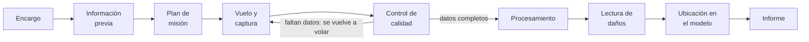

# Módulo 1. Fundamentos de la inspección de estructuras con drones

**Duración:** 2 h de teoría · **Competencia:** C1

El dron lleva la cámara a donde el inspector no llega fácil, rápido o seguro; detecta, prioriza y documenta, pero el diagnóstico se confirma de cerca o con ensayos.

**Objetivos de aprendizaje.** Al terminar el módulo, el participante:

1. Explica para qué se inspecciona una estructura y qué tipos de inspección existen.
2. Identifica en qué partes de una inspección aporta un dron y en cuáles no.
3. Describe el flujo completo de una inspección con dron, desde el encargo hasta el informe.

## 1.1 Para qué se inspecciona una estructura

Una inspección busca evidencia del estado actual de una estructura para decidir algo: seguir usándola, mantenerla, repararla, reforzarla, restringir su uso o estudiarla más a fondo. Toda inspección parte de una pregunta; sin pregunta, el resultado es un álbum de fotos.

| Tipo de inspección | Pregunta que responde | Ejemplo |
| --- | --- | --- |
| Inicial o de inventario | ¿Qué hay y en qué estado está? | Línea base de un edificio recién adquirido |
| Rutinaria (periódica) | ¿Qué cambió desde la última vez? | Revisión anual de fachadas y cubiertas |
| Especial o de diagnóstico | ¿Qué causa este daño y qué tan grave es? | Fisuras en vigas tras una remodelación |
| Posevento | ¿Es seguro ocupar o usar la estructura? | Después de un sismo, incendio, inundación o impacto |
| De recibo o de obra | ¿Se construyó como se diseñó? | Control de avance o de calidad de fachadas |

## 1.2 Qué aporta un dron y qué no

| Aporta | No aporta (o aporta poco) |
| --- | --- |
| Acceso a fachadas, cubiertas, aleros, torres, chimeneas y tableros de puentes sin andamios, alzahombres ni trabajo en altura | Contacto: no percute, no toca, no raspa, no mide espesores ni durezas |
| Cobertura completa y sistemática: cada metro cuadrado queda registrado | Ver dentro del material: corrosión de la armadura sin manifestación externa, vacíos internos |
| Registro objetivo y repetible, que se puede volver a mirar y comparar en el tiempo | Ensayos: núcleos, esclerometría, ultrasonido, carbonatación, cloruros |
| Modelos 3D y ortomosaicos medibles | Juicio estructural: la imagen no dice si el elemento es suficiente |
| Termografía de grandes superficies | Zonas sin línea de vista: detrás de equipos, interiores cerrados, juntas ocultas |
| Rapidez en emergencias y en zonas de riesgo para personas | Operación con lluvia, viento fuerte o sin autorización de vuelo |

La regla del curso: **el dron detecta, prioriza y documenta; el diagnóstico se confirma con la inspección de cerca o con ensayos cuando el hallazgo lo amerita.** El informe debe decir con claridad qué se observó desde el aire y qué falta verificar (módulo 10).

**Beneficios y costos frente a la inspección tradicional:**

- **Seguridad:** reduce el trabajo en altura y la exposición en zonas dañadas, pero introduce un riesgo nuevo, la caída de la aeronave, que se gestiona en el módulo 2.
- **Tiempo:** una fachada de 30 × 24 m se fotografía completa en menos de una hora de vuelo (módulo 4). Procesar y revisar las fotos puede tardar más que el vuelo, y hay que presupuestarlo.
- **Costo:** evita andamios, canastas y cierres prolongados, pero exige personal certificado, autorización, seguros y equipo.
- **Datos:** genera cientos o miles de fotos por estructura. Sin un método de nombres, respaldo y revisión (módulo 10), la información se pierde.

## 1.3 Estructuras que se inspeccionan con dron

- **Edificaciones:** fachadas (enchapes, albañilería, muros cortina, balcones, cornisas), techumbres (losas, membranas, tejas, cubiertas livianas, canaletas y bajadas de aguas lluvias), elementos de hormigón o acero expuestos, juntas de dilatación sísmica, estanques elevados.
- **Puentes:** tablero, vigas, apoyos, juntas de expansión, pilas, estribos, cables y pendolones. Requieren cámara que mire hacia arriba o un dron con cámara superior, y vuelo sin GNSS bajo el tablero.
- **Estructuras industriales y de servicios:** torres de telecomunicaciones y de transmisión, chimeneas, silos, estanques, galpones industriales, estadios.
- **Patrimonio:** registro sin contacto de fachadas y cubiertas históricas.

## 1.4 Flujo de una inspección con dron

El control de calidad en sitio es la única vuelta atrás barata del flujo: si falta algo, se vuela de nuevo antes de recoger el equipo.

1. **Encargo:** quién pide la inspección, para qué, con qué alcance y qué entregables. Se fija la pregunta.
2. **Información previa:** planos, modelo estructural, inspecciones anteriores, reparaciones, eventos (sismos, impactos). Del modelo se toman los elementos más exigidos (relación demanda/capacidad y derivas): son los primeros que hay que mirar.
3. **Plan de misión:** qué se fotografía, con qué sensor, a qué resolución, por qué ruta, con qué riesgos y qué permisos (módulos 2 y 4).
4. **Vuelo y captura** (módulo 5).
5. **Control de calidad en sitio:** antes de recoger el equipo se revisa que las fotos estén nítidas y que no falten zonas. Si falta algo, se vuelve al paso 4: volver otro día cuesta mucho más.
6. **Procesamiento:** selección de fotos, modelo 3D, ortomosaicos, termogramas (módulos 7 y 8).
7. **Lectura de daños:** cada daño se convierte en un hallazgo con ficha (módulo 6 y anexo B).
8. **Ubicación en el modelo:** cada hallazgo se asigna a un elemento estructural (módulo 9).
9. **Informe:** hallazgos, severidad, limitaciones y recomendaciones (módulo 10).

## 1.5 El equipo de inspección

| Rol | Responsabilidad | ¿Puede ser la misma persona? |
| --- | --- | --- |
| Piloto al mando | Seguridad del vuelo, cumplimiento de la autorización, decisión final de volar o no | No debe ser el operador de cámara en vuelos cerca de estructuras |
| Observador visual | Vigila el espacio aéreo, la distancia a obstáculos y las personas | No |
| Operador de cámara o inspector | Encuadre, exposición y decisión de qué fotografiar; reconoce el daño en vivo | Puede ser el ingeniero |
| Ingeniero responsable | Define la pregunta, interpreta y firma el informe | Puede ser el inspector |
| Coordinador de sitio | Cierre de áreas, comunicación con ocupantes y administración | Puede ser el observador en operaciones pequeñas |

Volar y mirar el daño a la vez divide la atención; cerca de una fachada es la receta de un accidente. Por eso el curso trabaja con equipos de al menos dos personas y, de preferencia, tres.

## Errores frecuentes

- Salir a volar sin una pregunta clara: se vuela mucho y se responde poco.
- Creer que el dron reemplaza la inspección de cerca: el informe termina afirmando cosas que la imagen no puede probar.
- No revisar las fotos antes de irse del sitio.
- No consultar el modelo estructural antes de volar: se pasa por alto el elemento más exigido.

## Autoevaluación

1. Nombre tres tipos de inspección y la pregunta que responde cada uno.
2. Cite dos daños que un dron puede detectar bien y dos que no puede confirmar sin contacto o ensayo.
3. ¿Por qué el piloto no debe ser el operador de cámara cuando se vuela cerca de una fachada?
4. ¿Qué información del modelo estructural conviene revisar antes de planear el vuelo y por qué?

## Cómo explicar este módulo (guía del instructor)

**Idea central que el grupo debe llevarse:** el dron es la cámara del inspector, no el inspector; toda inspección empieza con una pregunta y termina en una decisión.

**Preparación:**

- Dos juegos de fotos de una misma fachada: uno tomado sin plan (fotos sueltas, encuadres variados) y otro de una inspección planificada (cobertura sistemática con detalles).
- Cinco tarjetas de encargo para el ejercicio de tipos de inspección (ver secuencia).
- Pizarra o papelógrafo para dibujar el flujo de la sección 1.4.
- El simulador de vuelo o un control de dron apagado para la dinámica de roles.

**Secuencia de la clase (120 min):**

| Min | Bloque | Qué hace el instructor | Qué hacen los participantes |
| --- | --- | --- | --- |
| 0-10 | Apertura | Muestra los dos juegos de fotos y pregunta: "¿qué decisión puede tomar el administrador con cada uno?" | Comparan y responden en voz alta |
| 10-30 | 1.1 Tipos de inspección | Reparte las tarjetas de encargo y pide clasificar cada una y escribir su pregunta | En parejas clasifican y formulan la pregunta; se ponen en común |
| 30-55 | 1.2 Qué aporta y qué no | Construye con el grupo una tabla de dos columnas; luego la contrasta con la tabla del manual | Proponen ejemplos para cada columna |
| 55-65 | Pausa |  |  |
| 65-90 | 1.3 y 1.4 Estructuras y flujo | Dibuja el flujo paso a paso; se detiene en el control de calidad en sitio | Copian el flujo y lo aplican al caso conductor |
| 90-110 | 1.5 Roles | Dirige la dinámica de atención dividida | Un participante "vuela" mientras otro le pide encuadres; luego se separan los roles |
| 110-120 | Cierre | Presenta el caso conductor y su pregunta | Responden la autoevaluación en parejas |

**Tarjetas de encargo sugeridas:** (1) un condominio en Ñuñoa pide revisar la fachada antes de pintarla, inspección inicial; (2) el mismo condominio repite la revisión al año siguiente, rutinaria; (3) aparecen fisuras en vigas tras una remodelación, especial; (4) un sismo de magnitud 7 afecta la ciudad, posevento; (5) una constructora quiere verificar el revestimiento de una torre nueva, de recibo.

**Cómo explicar los puntos clave:**

- **"Toda inspección parte de una pregunta".** Use la analogía del examen médico: nadie pide "todos los exámenes"; el médico pide los que responden a su sospecha. La pregunta decide qué se fotografía, con qué resolución y qué se entrega.
- **"El dron detecta, prioriza y documenta".** Muestre una foto de un enchape que se ve sano y cuéntele al grupo que a la percusión sonaba hueco. Pregunte: "¿podría el dron haberlo confirmado?". Respuesta: no; podría sospecharlo con termografía, pero la confirmación es en sitio.
- **El control de calidad como única vuelta atrás barata.** Haga la cuenta con el grupo: volver otro día significa nueva movilización, quizá una nueva autorización de la DGAC y esperar el clima. Revisar en el portátil cuesta 20 minutos.
- **Atención dividida.** Durante la dinámica, quien "vuela" pierde la noción de la distancia en cuanto empieza a mirar el encuadre. Esa experiencia explica mejor que cualquier norma por qué se separan los roles.

**Preguntas para la clase (con respuesta esperada):**

- "¿Qué diferencia hay entre una inspección rutinaria y una especial?" La rutinaria compara con la vez anterior; la especial busca la causa y la gravedad de un daño concreto.
- "¿Por qué miramos el modelo estructural antes de volar?" Porque indica los elementos más exigidos, que deben ir a la lista de detalle.
- "¿Qué no puede hacer el dron?" Tocar, percutir, ensayar ni juzgar la capacidad del elemento.

**Dificultades frecuentes y cómo abordarlas:**

- Quienes vienen del vuelo quieren pasar rápido a volar: asígneles en la dinámica el rol de operador de cámara para que vivan la otra mitad del trabajo.
- Los ingenieros subestiman la operación aérea: pídales estimar el tiempo de una inspección completa y luego muéstreles el tiempo real con traslados, chequeos y control de calidad.
- Preguntas de encargo vagas ("ver cómo está el edificio"): devuélvalas con "¿qué decidirá el cliente con esto?".

**Verificación de cierre:** cada participante escribe en una tarjeta la pregunta del caso conductor y un límite de lo que el dron podrá responder. Revise las tarjetas antes del módulo siguiente.
