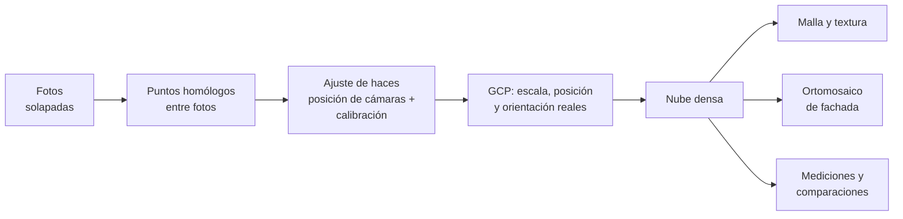

# Módulo 8. Fotogrametría y modelos 3D

**Duración:** 5 h (2.5 h teoría + 2.5 h práctica de procesamiento) · **Competencia:** C8

## Objetivos de aprendizaje

1. Explica el flujo de la fotogrametría con dron (SfM) y sus requisitos de
   captura.
2. Diseña la red de puntos de control y de chequeo de una estructura.
3. Procesa un bloque de fotos y controla la calidad del resultado.
4. Usa la nube de puntos y el ortomosaico de fachada para medir y comparar.

---

## 8.1 De las fotos al modelo

La fotogrametría por **estructura a partir del movimiento** (*Structure from
Motion*, SfM) reconstruye la geometría a partir de muchas fotos solapadas:

1. **Puntos homólogos:** el programa encuentra el mismo detalle en varias
   fotos. Requiere textura (superficies lisas, vidrio y agua fallan) y solape.
2. **Ajuste de haces** (*bundle adjustment*): calcula la posición y la
   orientación de cada foto y la calibración de la cámara.
3. **Georreferenciación:** los puntos de control (GCP) o las posiciones RTK de
   las fotos dan escala, posición y orientación reales.
4. **Nube densa, malla y textura:** el modelo 3D.
5. **Productos:** ortomosaicos (también de fachada, proyectados sobre un plano
   vertical), modelos de superficie, secciones, mediciones.

## 8.2 Requisitos de captura

- **Solape:** 80 % frontal y 70 % lateral en fachadas (módulo 4); 75-80 % y
  65-70 % en cubiertas. Cada punto de la superficie debe verse en **al menos 3
  fotos**, mejor más.
- **Fotos convergentes y oblicuas:** en esquinas, cornisas, balcones y
  cambios de plano. Un bloque con todas las fotos paralelas reconstruye mal la
  profundidad y la calibración.
- **Focal y enfoque fijos** dentro de un bloque. Las fotos de zoom de detalle
  se procesan aparte o no se incluyen.
- **Obturador mecánico** o fotos en estacionario, y nitidez < 0.5 px.
- **Iluminación pareja:** evite mezclar fotos de sol y de sombra de la misma
  zona.
- **Superficies problemáticas:** vidrio, metal pulido, superficies uniformes
  sin textura. Se complementan con LiDAR o con mediciones topográficas.

## 8.3 Puntos de control y de chequeo

| Tipo | Para qué | Cuántos (guía del curso) |
|---|---|---|
| **GCP (control)** | Entran al ajuste: fijan escala, posición y orientación | Mínimo 5, distribuidos en todo el objeto y en **distintas alturas** |
| **Puntos de chequeo** | **No** entran al ajuste: miden la exactitud real del modelo | Mínimo 3, independientes de los GCP |

- **Dianas** en el terreno y en la cubierta, o **puntos naturales** bien
  definidos en la fachada (esquinas de ventanas, aristas), medidos con
  **estación total sin prisma** desde una base georreferenciada.
- Coordenadas con GNSS RTK o con estación total en el mismo sistema que el
  proyecto, con su tipo de altura declarado (módulo 9).
- Con fotos RTK/PPK se pueden reducir los GCP, pero **nunca los puntos de
  chequeo**: junto a fachadas la solución RTK se degrada (módulo 3).
- Si el modelo estructural se georreferenció con puntos de control de Tav0t
  (`ejemplos/proyecto_puntos_control.json`), conviene que la fotogrametría use
  **la misma red de puntos**: así el modelo 3D y el modelo estructural quedan
  en el mismo marco.

## 8.4 Control de calidad

El informe de procesamiento debe mostrar, como mínimo:

| Indicador | Qué revisar | Criterio orientativo |
|---|---|---|
| Fotos alineadas | % de fotos que entraron al modelo | > 95 %; revise dónde están las que faltan |
| Error de reproyección | Coherencia interna del ajuste | Del orden de 1 px o menos |
| RMS en GCP | Ajuste a los puntos de control | Pocos GSD |
| **RMS en puntos de chequeo** | **Exactitud real** | **El indicador que se reporta** |
| GSD logrado | Resolución real del producto | El del plan |
| Cobertura | Zonas sin datos o con pocas fotos | Ninguna zona de interés sin cubrir |

Con buena captura y calibración, se puede esperar una exactitud relativa del
orden de 1 a 3 veces el GSD. Si los puntos de chequeo dan mucho más, algo
falla: GCP mal identificados, alturas mezcladas (h y H, módulo 9), fotos
movidas, poca convergencia.

## 8.5 Productos y usos en inspección

- **Ortomosaico de fachada:** imagen única, a escala, de toda la fachada.
  Permite mapear daños (polígonos de desprendimientos, líneas de fisuras),
  medir longitudes y áreas, y cuantificar para el presupuesto de reparación.
- **Nube de puntos y malla:** geometría medible.
  - **Desplome o inclinación:** ajuste de líneas a las aristas verticales y
    comparación con la vertical.
  - **Deformación de cubiertas y losas:** perfiles y mapas de desviación
    respecto a un plano.
  - **Secciones** para verificar dimensiones contra planos.
- **Comparación multitemporal:** dos modelos de fechas distintas, en el mismo
  marco de referencia (los mismos GCP), se comparan nube contra nube (por
  ejemplo con el método M3C2 de CloudCompare) para detectar cambios por encima
  de la incertidumbre. Es la base del seguimiento de daños en el tiempo.
- **Insumo para BIM y gemelo digital:** los hallazgos se ubican sobre el
  modelo 3D y sobre el modelo estructural (módulo 9).

## 8.6 Software

- **Comercial:** Agisoft Metashape, Pix4D, Bentley iTwin Capture (antes
  ContextCapture), entre otros.
- **Libre:** OpenDroneMap / WebODM y Meshroom para la reconstrucción;
  CloudCompare para nubes de puntos y comparaciones; QGIS para ortomosaicos y
  mapas.

El curso no depende de un programa: los conceptos de captura, control y
calidad son los mismos.

---

## Práctica (2.5 h)

Con las fotos del vuelo de fachada del módulo 5 (o el conjunto del curso):

1. Alinear las fotos y revisar las que no entran.
2. Marcar los GCP en las fotos y dejar los puntos de chequeo fuera del ajuste.
3. Generar la nube densa y el ortomosaico de fachada.
4. Leer el informe de calidad y llenar la tabla 8.4.
5. Medir el área de un desprendimiento y la longitud de una fisura en el
   ortomosaico, y la inclinación de una arista en la nube.

## Errores frecuentes

- Reportar el RMS de los GCP como exactitud del modelo.
- GCP todos en el suelo para un edificio alto: la parte alta queda mal
  controlada.
- Mezclar alturas elipsoidales y ortométricas entre la fotogrametría y la
  topografía.
- Incluir fotos de zoom en el mismo bloque que la gran angular.
- Medir inclinaciones sobre una foto oblicua.

## Autoevaluación

1. ¿Por qué los puntos de chequeo no deben entrar al ajuste?
2. ¿Qué pasa con la exactitud de la parte alta de una fachada si todos los GCP
   están en el suelo?
3. Si el GSD es 1.64 mm/px, ¿qué exactitud relativa puede esperar?
4. ¿Qué condición hace válida la comparación de dos modelos de fechas
   distintas?

Respuestas en el [anexo C](anexos/C_evaluacion.md#1-respuestas-de-las-autoevaluaciones).
