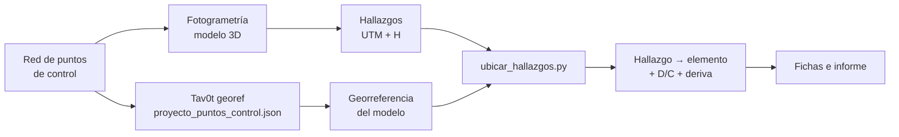

# Módulo 9. Georreferenciación de hallazgos e integración con el modelo estructural

**Duración:** 2 h (0.5 h teoría + 1.5 h laboratorio) · **Competencia:** C9

## Objetivos de aprendizaje

1. Evita los errores de sistema de coordenadas y de alturas que mueven un
   hallazgo de piso o de elemento.
2. Lleva los hallazgos de la inspección al sistema del modelo estructural con
   Tav0t y los asigna a elementos.
3. Usa los resultados del análisis (demanda/capacidad, derivas) para
   priorizar los hallazgos.

El fundamento de este módulo está en el
[guion de funcionamiento del módulo de georreferenciación](../GUION_DE_FUNCIONAMIENTO.md),
secciones 2 (conceptos) y 5.6 (ajuste por puntos de control).

---

## 9.1 Por qué ubicar el hallazgo en el modelo

Una ficha que dice "fisura en la fachada sur, piso 2" sirve para mandar a
alguien a mirarla. Una que dice "fisura de cortante en la columna `C1-02`,
relación D/C 0.86 en el caso sísmico" sirve para **decidir**. Ubicar el
hallazgo en el modelo:

- Relaciona el daño con la demanda calculada: un daño en un elemento muy
  exigido es más preocupante.
- Permite volver al mismo elemento en la siguiente inspección y comparar.
- Pone los hallazgos en el mismo mapa que el modelo (GeoJSON en QGIS, KML en
  Google Earth).

## 9.2 Los tres errores que mueven un hallazgo

### 1. Alturas elipsoidales y ortométricas mezcladas

El GNSS y muchos programas de fotogrametría trabajan con **altura elipsoidal
h**; los planos y la topografía con **altura ortométrica H**. Se relacionan con
la ondulación geoidal *N* del sitio:

```math
h = H + N
```

Si los puntos de control se dieron con H y los hallazgos salen con h (o al
revés), **todo se mueve N metros en vertical**. En el edificio de ejemplo
N = 4 m: más que la altura de un piso. El laboratorio provoca este error a
propósito.

### 2. Sistema o zona de proyección distintos

- Verifique que los hallazgos y el proyecto están en el **mismo datum**
  (WGS84 o MAGNA-SIRGAS, que para ubicar una obra difieren en menos de un
  metro; ver la sección 2.5 del guion) y en la **misma zona UTM**.
- En Colombia la cartografía oficial usa la proyección **Origen Nacional
  (CTM12)**. El módulo de Tav0t trabaja con coordenadas geodésicas y UTM: si
  la fotogrametría se procesó en CTM12, exporte los hallazgos en latitud,
  longitud o UTM.

### 3. Norte verdadero y norte de cuadrícula

Si el acimut del modelo se tomó de un plano en UTM y se declaró como
verdadero, el modelo queda girado la convergencia de meridianos (0.077° en el
ejemplo: 1.3 cm en 10 m). Es pequeño en un edificio, pero no en un puente
largo. El módulo de Tav0t lo corrige si se declara `"norte": "cuadricula"`.

## 9.3 Flujo de integración



La **misma red de puntos de control** georreferencia el modelo 3D de la
fotogrametría y el modelo estructural. Así ambos quedan en el mismo marco.

---

## 9.4 Laboratorio

Edificio de ejemplo de Tav0t: pórtico de concreto de 3 pisos, 12 × 10 m,
columnas en los ejes A-B-C (x = 0, 6, 12 m) y 1-2-3 (y = 0, 5, 10 m), pisos a
3.5, 6.5 y 9.5 m. Los resultados del análisis son sintéticos (solo para el
curso). Los hallazgos de `ejemplos/curso_drones/hallazgos.json` simulan lo que
entrega el modelo fotogramétrico: coordenadas UTM y altura ortométrica, con un
error de un par de centímetros.

Nomenclatura de elementos: `C{piso}-{iy}{ix}` columnas, `VX{piso}-{iy}{ix}` y
`VY{piso}-{iy}{ix}` vigas en dirección X y Y, `L{piso}-{iy}{ix}` losas, donde
`ix` e `iy` son los índices de los ejes (0, 1, 2).

### Paso 1. Georreferenciar el modelo con los puntos de control

```bash
python -m tav0t.georef ejecutar ejemplos/proyecto_puntos_control.json
```

Revise en la salida el RMS del ajuste (1.5 mm en horizontal y 3.1 mm en
vertical) y las derivas por piso. El piso 2 (3.50-6.50 m) tiene la deriva más
alta: 0.00486. Abra `ejemplos/salida/puntos_control/georref.kml` en Google
Earth.

### Paso 2. Ubicar los hallazgos

```bash
python ejemplos/curso_drones/ubicar_hallazgos.py
```

Salida esperada:

```
Hallazgo        x       y       z  Elemento    d (m)  Tipo
H01         12.00   -0.25    1.83  C1-02        0.25  Fisura diagonal
H02          3.00   -0.15    6.11  VX2-00       0.42  Fisura vertical
H03         12.14    1.20    9.16  VY3-02       0.37  Desprendimiento con acero expuesto
H04          9.21    2.58    9.55  L3-01        0.05  Mapa de fisuras
H05          2.99   10.14    5.21  ¿VX2-20?     1.29  Anomalía térmica
H06         -0.26   10.03    0.33  C1-20        0.26  Fisura horizontal

A más de 0.6 m de todo elemento del modelo: H05. Revise si están en un elemento no modelado o si hay un error de coordenadas o de alturas.
```

Qué hace el script:

1. Ejecuta la georreferencia del proyecto y la reconstruye
   (`Georreferencia`).
2. Convierte cada hallazgo de UTM + H a geodésicas y suma *N* para obtener h.
3. Lo lleva al sistema del modelo con `geodesicas_a_modelo`.
4. Calcula la distancia a cada barra (segmento) y a cada losa (polígono) y se
   queda con el elemento más cercano.
5. Si la distancia supera la tolerancia (0.6 m: medio lado de la sección más
   grande más el error del modelo fotogramétrico), lo marca con `¿?`.

La distancia de 0.25 m de `H01` es la mitad del lado de la columna de 50 cm:
la fisura está en la cara exterior, y el modelo trabaja con ejes.

### Paso 3. Interpretar el hallazgo sin elemento

`H05` es una anomalía térmica en el **muro de fachada del eje 3, piso 2**. El
muro de mampostería de relleno no está en el modelo: por eso queda a 1.29 m de
la viga más cercana. **No se descarta**: se reporta asociado al pórtico del
eje 3 entre los ejes A y B, en el piso de **mayor deriva** del edificio. La
pregunta para la verificación en sitio es si la anomalía es humedad (lo que
sugiere su forma) o daño del muro por interacción con el pórtico (módulo 6.4).

### Paso 4. Priorizar con el análisis

Complete la tabla con la relación D/C del caso `SISMO_X` (archivo
`ejemplos/edificio_3p.json`, sección `resultados`):

| Hallazgo | Elemento | D/C | Comentario |
|---|---|---|---|
| H01 | C1-02 | 0.86 | Fisura de cortante en columna esquinera de planta baja, elemento muy exigido |
| H02 | VX2-00 | 0.78 | Fisura de flexión en viga de fachada |
| H03 | VY3-02 | 0.38 | Corrosión: problema de durabilidad más que de demanda |
| H04 | L3-01 | — | Losa de cubierta: retracción y falta de impermeabilización |
| H05 | (muro, eje 3) | — | Piso de mayor deriva |
| H06 | C1-20 | 0.92 | Fisura horizontal en el arranque de una columna esquinera de planta baja |

¿Qué hallazgos irían primero a verificación de cerca? Justifique con la
severidad, la confianza y la D/C.

### Paso 5. Provocar el error de alturas

Suponga que la fotogrametría entregó los hallazgos con alturas mezcladas y
que, en la práctica, se convierten sin sumar la ondulación geoidal:

```bash
python ejemplos/curso_drones/ubicar_hallazgos.py --ondulacion 0
```

```
Hallazgo        x       y       z  Elemento    d (m)  Tipo
H01         12.00   -0.25   -2.17  ¿C1-02?      2.19  Fisura diagonal
H02          3.00   -0.15    2.11  ¿VX1-00?     1.40  Fisura vertical
H03         12.14    1.20    5.16  ¿C2-02?      1.21  Desprendimiento con acero expuesto
H04          9.21    2.58    5.55  ¿L2-01?      0.95  Mapa de fisuras
H05          2.99   10.14    1.21  ¿VX1-20?     2.29  Anomalía térmica
H06         -0.26   10.03   -3.67  ¿C1-20?      3.68  Fisura horizontal
```

Todos los hallazgos bajan **exactamente N = 4 m**: dos quedan bajo el suelo y
los demás en el piso de abajo. Observe que la planta (x, y) no cambia. **Si
todos los hallazgos se desplazan lo mismo en vertical, sospeche de las
alturas antes que de la fotogrametría.** Si el error fuera en planta, revise
la zona UTM, el datum o el norte.

### Paso 6. Llevar los hallazgos a las fichas

Para `H01` y `H06`, diligencie la ficha de hallazgo del
[anexo B](anexos/B_formatos.md#2-ficha-de-hallazgo) (el anexo trae `H01` como
ejemplo resuelto).

### Variaciones

- Ubique los hallazgos con el proyecto paramétrico
  (`--proyecto ejemplos/proyecto_parametrico.json`) y compare: las diferencias
  son de 1 a 2 cm, del orden del ajuste.
- Cambie la tolerancia (`--tolerancia 0.3`) y discuta qué hallazgos cambian y
  por qué.

---

## Errores frecuentes

- Usar alturas elipsoidales en unos datos y ortométricas en otros.
- Georreferenciar el modelo estructural y la fotogrametría con redes de
  puntos distintas.
- Descartar un hallazgo porque "no cae en ningún elemento".
- Olvidar que el modelo trabaja con ejes y los daños están en las caras.

## Autoevaluación

1. Todos los hallazgos aparecen 4 m más abajo que en la realidad. ¿Qué error
   sospecha?
2. ¿Por qué un hallazgo puede quedar lejos de todo elemento del modelo sin que
   haya error?
3. ¿Por qué conviene usar la misma red de puntos de control para la
   fotogrametría y para el modelo estructural?
4. ¿Cómo cambia la prioridad de una fisura la relación D/C del elemento?

Respuestas en el [anexo C](anexos/C_evaluacion.md#1-respuestas-de-las-autoevaluaciones).
